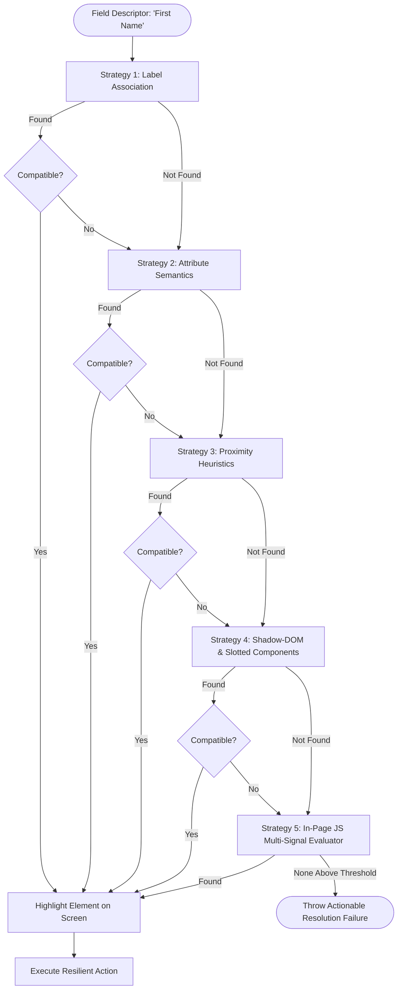

# Task 1: Resilient Form Automation (C# + Selenium)

> A resilient, self-healing automated testing solution built in C# (.NET 8) and Selenium WebDriver that automates the **First Name**, **Gender**, and **State** fields on `https://app.cloudqa.io/home/AutomationPracticeForm` and remains robust against DOM mutations, attribute shifts, structural reordering, and similar distractor fields.

---

## 🎯 Key Objectives Addressed

1. **Automation of 3 Target Fields**:
   - **First Name** (text box)
   - **Gender** (radio button)
   - **State** (dropdown / select)
2. **Resilience to Page Changes**:
   - Fields moving to different positions/order.
   - Randomized or completely changed `id`, `name`, `class` attributes.
   - HTML structural modifications (e.g. `<label>` wrapping input, table vs. div layouts, detached labels).
   - Similar/distractor fields on the page (e.g. "Last Name", "Middle Name", "State of Driver License").
3. **No Brittle Selectors**:
   - Zero dependence on fixed single XPaths or fragile CSS paths (e.g. no `//div[2]/form/div[3]/input`).
4. **Configurable Target URL**:
   - Configurable via `appsettings.json` and CLI arguments (`--url`).

---

## 🏗️ Architecture & Approach

### The Multi-Strategy Locator Chain (Chain of Responsibility + Scoring)

Rather than assuming a rigid DOM layout, the engine models each form field as a **semantic entity** (`FieldDescriptor`) with synonyms, expected control type, and negative discriminators.

When locating an element, the `SmartLocatorChain` evaluates 5 distinct locator strategies in priority order:



### Detailed Strategy Breakdown

| # | Strategy Name | Technique & Fallback Mechanism | Handled Mutations |
|---|---------------|--------------------------------|-------------------|
| **1** | **Label Association** | Checks `<label>` tags matching synonyms. Resolves via: `for` attribute $\rightarrow$ nested control $\rightarrow$ container query $\rightarrow$ trailing sibling. | Handles layout restructuring, removal of IDs, nested `<label><input/></label>` patterns. |
| **2** | **Attribute Semantics** | Evaluates `aria-label`, `placeholder`, `name`, `data-testid`, `title`, and `id` against synonyms and field substrings. | Handles modern label-less forms, custom design systems, and internationalized attribute values. |
| **3** | **Proximity Heuristics** | Identifies text rendered in `<span>`, `<div>`, `<b>`, `<p>`, or `<td>` and searches nearby spatial/DOM siblings in the same row or container. | Handles forms using custom typography components instead of HTML `<label>` tags. |
| **4** | **Shadow-DOM & Slotted Components** | Traverses shadow roots and slotted web components (`<slot name="...">`). | Handles Web Components, LitElement, and encapsulated shadow trees (as used in the CloudQA practice form). |
| **5** | **In-Page JS Multi-Signal Evaluator** | Executes in-browser scoring algorithm considering attribute similarity, distance to text, control visibility, and **negative penalty filtering** (e.g. penalizing "Last Name" when searching for "First Name"). | Handles heavily obfuscated DOMs, dynamic CSS-in-JS classes, and ambiguous forms. |

---

## ⚡ Field Interaction Actions

Each field type has a dedicated action handler that handles modern web framework quirks (such as React/Vue controlled state):

- **`TextFieldAction`**:
  - Focuses and scrolls element into view.
  - Clears using `element.Clear()`, with fallback to `Ctrl+A, Backspace` (needed for React/Vue).
  - Enters value and dispatches native browser `input` and `change` events.
  - Verifies value retention with JavaScript fallback setter if needed.
- **`RadioButtonAction`**:
  - Resolves target option by value, id, label text, or adjacent span text.
  - Scrolls into view.
  - Handles `ElementClickInterceptedException` (e.g. styled radio overlay) by clicking the adjacent label/span or triggering native JS `.click()`.
  - Verifies `.checked` state.
- **`DropdownAction`**:
  - Handles native `<select>` elements with fuzzy trimmed/case-insensitive matching across text and value attributes.
  - Falls back to custom ARIA combobox / listbox options if standard `<select>` is not used.
  - Dispatches `change` events to trigger bound form listeners.

---

## 📁 Project Structure

```
Task1-ResilientFormAutomation/
├── ResilientFormAutomation.sln
│
├── ResilientFormAutomation.Core/          # Reusable automation engine library
│   ├── Config/
│   │   ├── AutomationSettings.cs         # URL, headless, timeout, and test data config
│   │   ├── ConfigurationLoader.cs        # appsettings.json + CLI args binder
│   │   └── FieldDescriptor.cs            # Semantic definitions for target fields
│   ├── Locators/
│   │   ├── ISmartLocatorStrategy.cs      # Strategy interface
│   │   ├── LocatorResult.cs              # Strategy match result & confidence score
│   │   ├── LabelAssociationStrategy.cs   # Strategy 1
│   │   ├── AttributeSemanticStrategy.cs  # Strategy 2
│   │   ├── ProximityHeuristicStrategy.cs # Strategy 3
│   │   ├── ShadowDomAndSlotStrategy.cs   # Strategy 4
│   │   ├── JsScoringFallbackStrategy.cs  # Strategy 5
│   │   └── SmartLocatorChain.cs          # Orchestrator & visual highlighter
│   ├── Actions/
│   │   ├── IFormAction.cs                # Action interface
│   │   ├── TextFieldAction.cs            # Resilient text input handler
│   │   ├── RadioButtonAction.cs          # Resilient radio button handler
│   │   └── DropdownAction.cs             # Resilient dropdown handler
│   └── FormAutomator.cs                  # High-level test orchestrator & report generator
│
├── ResilientFormAutomation.Cli/           # Standalone CLI console application
│   ├── Program.cs                        # CLI entry point, logging, exit codes
│   └── appsettings.json                  # User configuration file
│
└── ResilientFormAutomation.Tests/         # Comprehensive NUnit test suite
    ├── Fixtures/
    │   ├── MutatedPage1_AttributeMutation.html
    │   ├── MutatedPage2_ReorderedAndStructuralChanges.html
    │   ├── MutatedPage3_SimilarDistractorFields.html
    │   └── MutatedPage4_NoLabelsAttributeOnly.html
    └── ResilientFormTests.cs              # 5 automated tests (live + 4 mutated pages)
```

---

## 🚀 Setup & Execution Guide

### Prerequisites
- **.NET 8.0 SDK** ([Download .NET 8](https://dotnet.microsoft.com/download/dotnet/8.0))
- **Google Chrome** (Selenium 4 automatically manages the matching ChromeDriver)

### 1. Run via CLI (Console Application)

From the `Task1-ResilientFormAutomation` directory:

```bash
# Run against the default CloudQA practice form (headed mode)
dotnet run --project ResilientFormAutomation.Cli

# Run in headless mode
dotnet run --project ResilientFormAutomation.Cli -- --headless

# Run against a modified or custom page URL
dotnet run --project ResilientFormAutomation.Cli -- --url "https://custom-domain.com/modified-form"

# Customize test data via CLI flags
dotnet run --project ResilientFormAutomation.Cli -- --firstname "Grace" --gender "Male" --state "United States"
```

### 2. Configuration via `appsettings.json`

You can also edit `ResilientFormAutomation.Cli/appsettings.json` directly:

```json
{
  "AutomationSettings": {
    "PageUrl": "https://app.cloudqa.io/home/AutomationPracticeForm",
    "Headless": false,
    "TimeoutSeconds": 15,
    "HighlightElements": true,
    "ActionDelayMilliseconds": 300,
    "TestData": {
      "FirstName": "Jane",
      "Gender": "Female",
      "State": "Australia"
    }
  }
}
```

### 3. Run the Automated NUnit Test Suite

The test suite runs against both the live CloudQA form and 4 mutated fixture pages:

```bash
dotnet test
```

**Test Suite Coverage:**
1. `Test01_LiveCloudQAPracticeForm_ShouldAutomateSuccessfully` — Live execution on `app.cloudqa.io`.
2. `Test02_MutatedPage1_RandomizedIdsAndClasses_ShouldPass` — Survived randomized IDs, altered classes, removed `for` attributes.
3. `Test03_MutatedPage2_ReorderedAndStructuralChanges_ShouldPass` — Survived inverted field ordering (State $\rightarrow$ Gender $\rightarrow$ First Name) and nested `<label>` tags.
4. `Test04_MutatedPage3_SimilarDistractorFields_ShouldTargetCorrectFields` — Disambiguated First Name from "Middle Name" / "Last Name" and State from "State of Driver License".
5. `Test05_MutatedPage4_AccessibleAttributesWithoutLabels_ShouldPass` — Survived label-less modern UI with only ARIA attributes and placeholders.

---

## ⚠️ Limitations & Trade-offs

1. **Execution Overhead vs. Static Selectors**:
   - Evaluating multi-strategy chains takes 50–300 ms longer per field than an immediate brittle `#fname` selector. In test automation, this minor trade-off is almost always worth the prevention of false-positive build failures.
2. **Extreme Semantic Ambiguity**:
   - If a form has multiple identical fields with zero differentiating context (e.g. two unlabeled text boxes side by side without placeholder or ARIA hints), visual coordinates or parent container scoping must be explicitly provided.
3. **Canvas / WebGL Forms**:
   - Forms rendered entirely in HTML5 Canvas (e.g. Flutter Web without HTML renderer) do not have accessible DOM nodes and require visual computer vision (as explored in Task 2).
